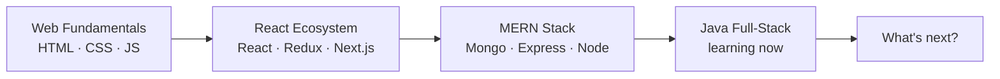

<!-- ═══════════ PROLOGUE ═══════════ -->
<p align="center">
  
</p>

<p align="center">
  <a href="https://github.com/jaykumarbuda23">
    
  </a>
</p>

<p align="center">
  <a href="https://github.com/jaykumarbuda23"></a>
  
  
</p>

<p align="center">
  <i>A story in six chapters about building modern, responsive,<br/>
  user-friendly web applications, and getting better at it every day.</i>
</p>

<p align="center">
  <a href="#chapter-1"><b>I · Origin</b></a> &nbsp;→&nbsp;
  <a href="#chapter-2"><b>II · Arsenal</b></a> &nbsp;→&nbsp;
  <a href="#chapter-3"><b>III · Proof</b></a> &nbsp;→&nbsp;
  <a href="#chapter-4"><b>IV · Trophies</b></a> &nbsp;→&nbsp;
  <a href="#chapter-5"><b>V · Work</b></a> &nbsp;→&nbsp;
  <a href="#chapter-6"><b>VI · Contact</b></a>
</p>

<!-- ═══════════ SPINE ═══════════ -->
<p align="center"><code>│</code><br/><code>│</code><br/><code>▼</code></p>

<!-- ═══════════ CHAPTER 1 ═══════════ -->
<a id="chapter-1"></a>
<p align="center">
  
</p>
<p align="center">
  
</p>

<p align="center">
  It started with curiosity about how the web works.<br/>
  It turned into a habit of <b>solving problems, exploring new technologies,</b><br/>
  and shipping things that people can actually use.
</p>

<table align="center" width="100%">
<tr>
<td valign="middle" width="78%">

```yaml
# >_ developer.profile
learning      : Java Full-Stack Development
ask_me_about  : MERN Stack Development
interested_in : AI | Web Applications | Software Development
education     : B.Tech in CSE - Biju Patnaik University of Technology
location      : Odisha, India
```

</td>
<td align="center" valign="middle" width="22%">
  <a href="https://github.com/jaykumarbuda23">
    
  </a>
  <br /><b>GITHUB</b><br /><sub>@jaykumarbuda23</sub>
</td>
</tr>
</table>

<p align="center"><sub><i>Next: the tools that made it possible ↓</i></sub></p>
<p align="center"><code>│</code><br/><code>│</code><br/><code>▼</code></p>

<!-- ═══════════ CHAPTER 2 ═══════════ -->
<a id="chapter-2"></a>
<p align="center">
  
</p>
<p align="center">
  
</p>

<p align="center"><i>Every story needs its tools. These are mine.</i></p>

<h3 align="center">🎨 Frontend: what people see</h3>
<p align="center">
  
  
  
  
  
  
  
  
  
</p>

<h3 align="center">⚙️ Backend: what makes it work</h3>
<p align="center">
  
  
  
  
</p>

<h3 align="center">🗄️ Database: where data lives</h3>
<p align="center">
  
</p>

<h3 align="center">🔧 Tools &amp; Testing: keeping it solid</h3>
<p align="center">
  
  
  
</p>

<h3 align="center">🧭 The path so far</h3>



<p align="center"><sub><i>Tools are just claims until they leave a trail. Here's the trail ↓</i></sub></p>
<p align="center"><code>│</code><br/><code>│</code><br/><code>▼</code></p>

<!-- ═══════════ CHAPTER 3 ═══════════ -->
<a id="chapter-3"></a>
<p align="center">
  
</p>
<p align="center">
  
</p>

<p align="center"><i>Consistency leaves a trail. This one updates live.</i></p>

<table align="center">
  <tr>
    <td width="33%" align="center">
      
    </td>
    <td width="33%" align="center">
      
    </td>
    <td width="33%" align="center">
      
    </td>
  </tr>
</table>

<p align="center">
  
</p>

<p align="center"><sub><i>And along the way, a few milestones ↓</i></sub></p>
<p align="center"><code>│</code><br/><code>│</code><br/><code>▼</code></p>

<!-- ═══════════ CHAPTER 4 ═══════════ -->
<a id="chapter-4"></a>
<p align="center">
  
</p>
<p align="center">
  
</p>

<p align="center">
  
</p>

<p align="center"><sub><i>Milestones are nice. The work itself is better ↓</i></sub></p>
<p align="center"><code>│</code><br/><code>│</code><br/><code>▼</code></p>

<!-- ═══════════ CHAPTER 5 ═══════════ -->
<a id="chapter-5"></a>
<p align="center">
  
</p>
<p align="center">
  
</p>

<p align="center">
  
</p>

<!-- OPTIONAL: featured projects. Replace YOUR_REPO_NAME with real repo names, or delete this block. -->
<h3 align="center">⭐ Featured projects</h3>
<p align="center">
  <a href="https://github.com/jaykumarbuda23/YOUR_REPO_NAME">
    
  </a>
  <a href="https://github.com/jaykumarbuda23/YOUR_REPO_NAME_2">
    
  </a>
</p>

<p align="center"><sub><i>Every story deserves a next chapter. Let's write it together ↓</i></sub></p>
<p align="center"><code>│</code><br/><code>│</code><br/><code>▼</code></p>

<!-- ═══════════ CHAPTER 6 ═══════════ -->
<a id="chapter-6"></a>
<p align="center">
  
</p>
<p align="center">
  
</p>

<p align="center">
  Got an idea, a project, or an opportunity?<br/>
  <b>Say hello. I'd love to hear it.</b>
</p>

<p align="center">
  <a href="https://github.com/jaykumarbuda23" target="_blank"></a>
  <a href="https://linkedin.com/in/jai-kumar-buda" target="_blank"></a>
  <a href="https://instagram.com/_r_e_x_x_0.8" target="_blank"></a>
  <a href="mailto:jaikumarbuda6@gmail.com"></a>
</p>

<!-- ═══════════ EPILOGUE ═══════════ -->
<p align="center">
  
</p>

<p align="center">
  
</p>
